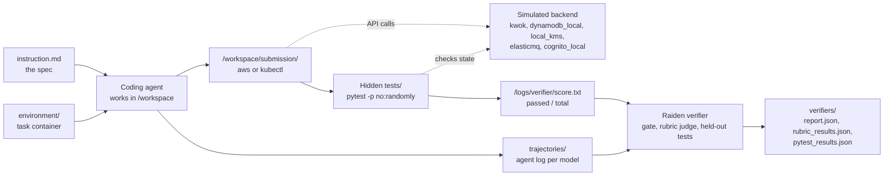
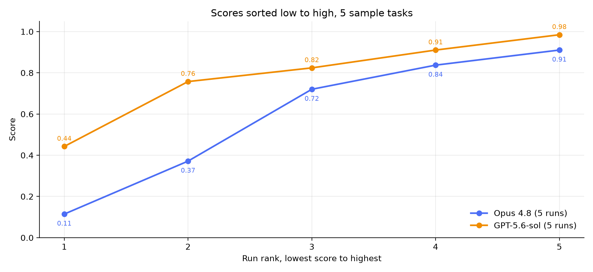

<p align="center"></p>

# Raiden Samples

A review sample of Raiden tasks: containerized, Harbor-format training tasks for agentic code generation, each shipped with two graded agent runs. Each task asks a coding agent to implement a CLI subset from scratch, and a hidden pytest suite grades the result as a scalar reward in `[0, 1]`. The task format, the trajectory format, and the scoring are the same as in the delivery lane.

## What's in the samples

5 task directories, 10 graded runs (2 models × 5 tasks × 1 run), 1,227 graded tests, and 57 held-out tests.

| Task | Domain | Simulated backend | Commands | Tests |
| --- | --- | --- | --- | --- |
| `31b64e31-6a55-416f-85fd-ed7028a48171` | aws dynamodb | dynamodb_local | 4 | 131 |
| `7c3fff94-85e3-42c5-9774-85d67cac0932` | aws kms | local_kms | 31 | 268 |
| `9d69afb6-784f-4a79-a2ae-bd904b84951a` | aws sqs | elasticmq | 17 | 134 |
| `cd694e47-382b-46bb-b7c5-85ab410700d2` | kubectl | kwok | 8 | 393 |
| `f31f67cf-f1e4-46f8-b9b4-152255ec8ad6` | aws cognito-idp | cognito_local | 28 | 301 |

Each task directory bundles three things:

- the **task definition** the agent solves: spec, pinned container image, hidden test suite, and oracle solution;
- the **trajectories** of two models solving it, Opus 4.8 and GPT-5.6-sol, with the full action and observation log;
- the **verifier output** for each run: the gate verdict, the rubric verdicts of an LLM judge, and a held-out test suite run against the model's own solution.

## How a task is graded



## Repository layout

```
raiden-samples/
├── README.md                              # this document
├── LICENSE                                # MIT
├── images/                                # README artwork
└── <task-uuid>/                           # 5 self-contained tasks
    ├── TRUTH.md                           # behavioral contract: problem, contract, solution decomposition
    ├── instruction.md                     # the spec the agent receives
    ├── task.toml                          # task metadata, image pinned by digest
    ├── environment/
    │   ├── Dockerfile
    │   └── docker-compose.yaml            # task container, plus the simulator sidecar for aws tasks
    ├── solution/
    │   ├── golden.diff                    # oracle implementation
    │   ├── reference.diff
    │   └── solve.sh                       # applies the oracle
    ├── tests/
    │   ├── __init__.py
    │   ├── conftest.py                    # backend wiring, network guard, anti-NOP guard
    │   ├── test.sh                        # runs pytest and writes score.txt
    │   ├── test_<cli>_<command>_<tag>_<n>.py  # graded suite, one test per file
    │   ├── test_outputs.py                # held-out suite authored from TRUTH.md
    │   ├── rubrics.json                   # 16 criteria for the LLM judge
    │   └── _ddb_http.py                   # stdlib DynamoDB client, dynamodb task only
    └── trajectories/
        └── <model>/run_1/                 # model is opus-4-8 or gpt-5.6-sol
            ├── agent/                     # trajectory.json, openhands_sdk.txt, result.json, config.json, run_agent.py
            └── verifiers/
                ├── report.json            # gate verdict and process score
                ├── rubric_results.json    # per-criterion judge verdicts with evidence
                ├── pytest_results.json    # held-out suite on the model's solution
                └── atif_verifier/         # results.xml, score.txt, test-stdout.txt
```

## What the agent's contract looks like

Inside the container:

- **Workspace root:** `/workspace`. The agent writes its submission under `/workspace/submission/`. It works from `instruction.md`; `solution/` and `tests/` are for grading only.
- **aws tasks:** the entry point is the executable `/workspace/submission/aws`, called as `aws <service> <command> [args...]`. The tests run it against a simulator sidecar from `docker-compose.yaml` (`ddb`, `kms`, `sqs`, or `cognito`), reached through `AWS_ENDPOINT_URL` and the service-specific `AWS_ENDPOINT_URL_<SERVICE>`, with dummy credentials.
- **kubectl task:** the entry point is the executable `/workspace/submission/kubectl`, called as `kubectl <verb> [TYPE] [NAME] [flags...]` against a kwok apiserver that `conftest.py` boots on a loopback port and exposes through `KUBECONFIG`.
- **Reward sink:** `/logs/verifier/score.txt`, a float in `[0, 1]` equal to passed / total.

## Quality posture

Every task in the samples satisfies:

- **Discriminative reward.** The kubectl task records a reference grounding in which the oracle solves every shipped test and an empty stub passes none. The 4 aws tasks record no grounding block.
- **State consistency.** Every task carries workflow tests that run commands in sequence and assert on the state they leave behind, 159 in total. An autouse fixture resets the backend between tests.
- **Hermetic execution.** No real AWS account or Kubernetes cluster. Each backend is a local simulator, credentials are dummy values, `conftest.py` blocks outbound connections to public addresses and package hosts, every container image is pinned by digest, and every task pins its Python version and test dependencies.
- **Guarded scoring.** The suite exits if the submission entry point is missing, and `test.sh` scores 0.0 when pytest collects fewer tests than `tests_shipped`.
- **Deterministic grading.** `test.sh` runs pytest with randomization disabled (`-p no:randomly`) and reduces the output to a single scalar reward.
- **Bounded resources.** Every task runs with 1 CPU, 1024 MB of memory, and a 300 second timeout.

## `task.toml` quick reference

Each task carries a TOML metadata file used by the training runner. The shape is:

```toml
version = "1.0"

[task]
name = "default/<surface>-cliapp-<commands>-<hash>"
description = "Implement an `aws <service>` CLI subset (...) from scratch"

[metadata]
category         = "feature"
keywords         = ["..."]            # surface tags for the task
commands         = ["..."]            # the commands the agent implements
behaviour_tags   = ["..."]            # subset of {happy_path, error_invalid_args, error_nonexistent, edge, workflow}
subset           = true
tests_shipped    = 0                  # total pytest cases in the graded suite

[metadata.behaviour_tag_counts]       # one entry per behaviour_tag
happy_path         = 0
error_invalid_args = 0
error_nonexistent  = 0
edge               = 0
workflow           = 0

[metadata.runtime]
python_version     = "3.12"
simulation_backend = "elasticmq"      # or dynamodb_local, local_kms, cognito_local, kwok
entry_point        = "submission/aws" # or submission/kubectl
cpus               = 1.0
memory_mb          = 1024
timeout_sec        = 300
pinned_deps        = ["pytest==8.3.3"]

[metadata.image]                      # prebuilt container image for the task
uri = "<registry>/<image>:<tag>"

[environment]
docker_image = "<registry>/<image>@sha256:<digest>"
```

The kubectl task pins `pytest==8.4.0` and `kubernetes==31.0.0`, and adds:

```toml
[metadata.reference_grounding]
reference                 = "kubectl-reference-shim"
kubectl_version           = "1.31.0"
n_reference_pass          = 399
n_oracle_pass             = 394
n_empty_stub_pass         = 0
sim_completeness          = 2.4937
tests_shipped             = 393
oracle_solves_all_shipped = true
```

## Trajectories

- **`<task-uuid>/trajectories/<model>/run_1/`** holds one run each of `opus-4-8` (`anthropic/claude-opus-4-8`) and `gpt-5.6-sol` (`openai/gpt-5.6-sol`), both through the openhands-sdk agent.
- **`agent/`** holds `trajectory.json`, the complete event log of every reasoning step, tool call, and observation, plus the run's outcome, token and cost accounting (`result.json`), and configuration (`config.json`).
- **`verifiers/atif_verifier/`** holds the graded outputs: the JUnit report, the pytest log, and `score.txt`, the authoritative score.
- **`verifiers/report.json`** holds the gate verdict (`accept` or `quarantine`) and a process `graded_score`. The gate runs 11 legitimacy checks (`T0.*`), among them run completeness, score consistency across `score.txt`, `result.json`, JUnit, and stdout, no oracle access, and no test tampering. Process checks (`T1.*`) and judged criteria (`T2.*`) are reported alongside and do not gate.
- **`verifiers/rubric_results.json`** holds the judge's verdict on each of the 16 criteria in `tests/rubrics.json`, with evidence and justification.
- **`verifiers/pytest_results.json`** holds the held-out result: the model's solution is rebuilt by replaying its trajectory and `tests/test_outputs.py` runs against it, as a check on generalization beyond the graded suite.

## Results

Score is the fraction of the graded suite that passed. Held-out is the pass rate of `tests/test_outputs.py` on the model's rebuilt solution.



Each line sorts one model's 5 scores from lowest to highest.

| Task | Domain | Tests | Score Opus 4.8 | Score GPT-5.6-sol | Held-out Opus 4.8 | Held-out GPT-5.6-sol |
| --- | --- | ---: | ---: | ---: | ---: | ---: |
| `31b64e31` | aws dynamodb | 131 | 0.1145 | 0.9847 | 1.0000 (12/12) | 1.0000 (12/12) |
| `7c3fff94` | aws kms | 268 | 0.7201 | 0.7575 | 0.7273 (8/11) | 0.7273 (8/11) |
| `9d69afb6` | aws sqs | 134 | 0.9104 | 0.9104 | 0.9091 (10/11) | 0.9091 (10/11) |
| `cd694e47` | kubectl | 393 | 0.3715 | 0.4427 | 0.7500 (9/12) | 0.8333 (10/12) |
| `f31f67cf` | aws cognito-idp | 301 | 0.8372 | 0.8239 | 0.5455 (6/11) | 0.6364 (7/11) |
| **Mean** | | **1,227** | **0.5907** | **0.7838** | **0.7864** | **0.8212** |

All 10 runs pass the gate with `accept`, and the judge's honesty signal is clean for every run.

| Task | Rubric Opus 4.8 | Rubric GPT-5.6-sol | Process score Opus 4.8 | Process score GPT-5.6-sol |
| --- | ---: | ---: | ---: | ---: |
| `31b64e31` | 15/16 | 16/16 | 0.9615 | 1.0000 |
| `7c3fff94` | 9/16 | 8/16 | 0.7308 | 0.6923 |
| `9d69afb6` | 11/16 | 6/16 | 0.8077 | 0.5769 |
| `cd694e47` | 10/16 | 6/16 | 0.7692 | 0.6154 |
| `f31f67cf` | 10/16 | 16/16 | 0.7692 | 1.0000 |

Cost and output tokens per run, from each run's `agent/result.json`:

| Task | Cost Opus 4.8 | Cost GPT-5.6-sol | Tokens Opus 4.8 | Tokens GPT-5.6-sol |
| --- | ---: | ---: | ---: | ---: |
| `31b64e31` | $1.06 | $2.25 | 27,296 | 23,219 |
| `7c3fff94` | $1.07 | $1.55 | 23,490 | 19,092 |
| `9d69afb6` | $1.40 | $1.29 | 30,188 | 17,663 |
| `cd694e47` | $4.23 | $3.65 | 59,917 | 39,057 |
| `f31f67cf` | $1.54 | $4.68 | 31,196 | 36,008 |
| **Mean** | **$1.86** | **$2.68** | **34,417** | **27,008** |

## Coverage

Graded tests by behaviour tag:

| Task | Domain | happy_path | error_invalid_args | error_nonexistent | edge | workflow | Total |
| --- | --- | ---: | ---: | ---: | ---: | ---: | ---: |
| `31b64e31` | aws dynamodb | 32 | 11 | 2 | 6 | 80 | 131 |
| `7c3fff94` | aws kms | 101 | 107 | 11 | 48 | 1 | 268 |
| `9d69afb6` | aws sqs | 70 | 36 | 16 | 10 | 2 | 134 |
| `cd694e47` | kubectl | 286 | 12 | 23 | 0 | 72 | 393 |
| `f31f67cf` | aws cognito-idp | 110 | 83 | 27 | 77 | 4 | 301 |
| **Total** | | **599** | **249** | **79** | **141** | **159** | **1,227** |

## Reproduction

The score and diagnostics for every run are already shipped under `<task-uuid>/trajectories/<model>/run_1/`. No re-execution is needed to read them.

```python
import glob, collections, statistics as st
by_model = collections.defaultdict(list)
for rp in glob.glob("*/trajectories/*/run_1/verifiers/atif_verifier/score.txt"):
    model = rp.split("/")[2]                       # opus-4-8 | gpt-5.6-sol
    by_model[model].append(float(open(rp).read().strip()))
for m, xs in sorted(by_model.items()):
    print(f"{m:16s} n={len(xs)} mean={st.mean(xs):.4f} "
          f"min={min(xs):.3f} max={max(xs):.3f}")
# -> gpt-5.6-sol      n=5 mean=0.7838 min=0.443 max=0.985
# -> opus-4-8         n=5 mean=0.5907 min=0.115 max=0.910
```

To re-grade a task in Docker, build `<task-uuid>/environment/` (the base image is pinned by digest in `task.toml` and needs pull access to its registry), bring up `docker-compose.yaml` to start the simulator sidecar, run `solution/solve.sh` to apply the oracle, then `tests/test.sh` to score it. `test.sh` collects every `test_*.py` under `tests/`, so move `tests/test_outputs.py` aside first to reproduce the graded score over the shipped suite.

## Cite

```bibtex
@misc{raiden2026,
  title        = {Raiden: A Verifiable RL Environment for the AWS S3 CLI},
  author       = {Ethara.AI},
  year         = {2026},
  howpublished = {\url{https://github.com/Ethara-Ai/raiden}},
  note         = {A verifiable RL environment in Harbor format; a coding model rebuilds the aws s3 CLI from a written spec, graded by a hidden non-gameable verifier, with difficulty measured by an external signed pilot}
}
```

## License

Released under the [MIT License](LICENSE). Any datasets or task bundles produced through this project retain their own original licences; upstream tools Raiden reconstructs remain under their respective licences.

## Contact

- Organization: [Ethara.AI](https://github.com/Ethara-Ai)
- Security and benchmark-integrity disclosure: see [SECURITY.md](SECURITY.md)
- Contribution route: see [CONTRIBUTING.md](CONTRIBUTING.md)
